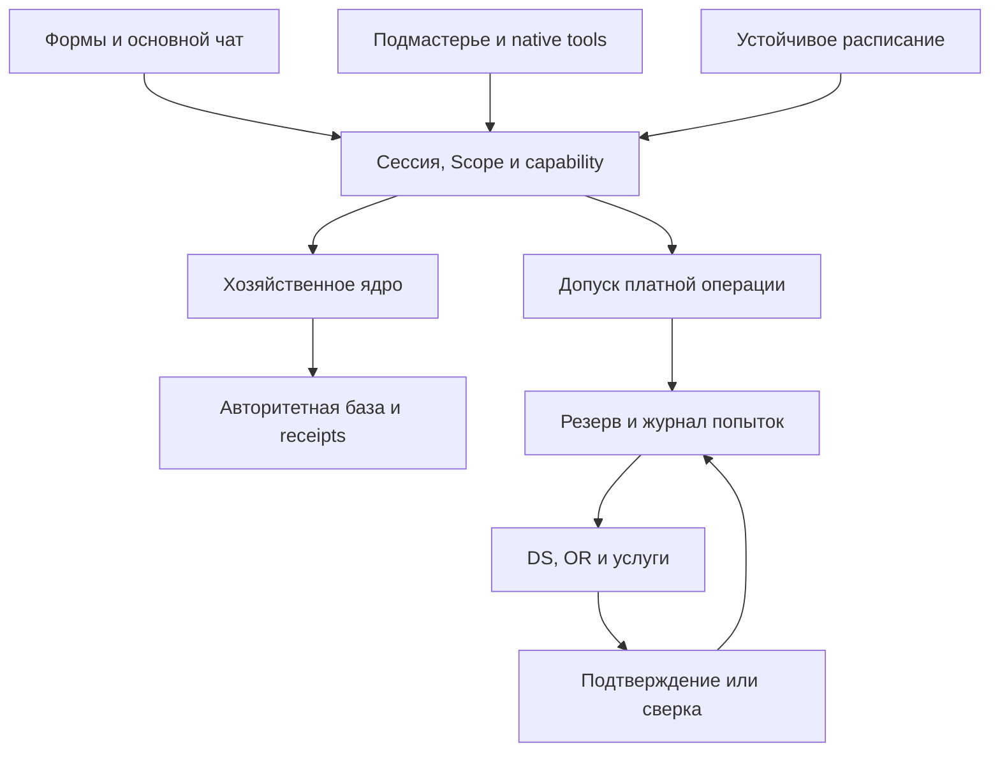

# Мастерская v31: архитектура единого переноса

## Основа и границы

Продукт — **Мастерская**, помощник — **Подмастерье**. Это единая композиция
существующего Harness и общих механизмов Octoport с хозяйственным ядром
Мастерской. Текущая рабочая версия Мастерской при сборке — Master v30,
`2be1cf6f4e04765fea5af33bba8b9a3e32d359fe`. Из актуального Octoport
`dacb7114476cad88b34932ade4c03942a058060a` перенесены применимые исправления
native gateway, контекста, восстановления и маршрутизации. Полные исходники
этого кандидата фиксируются отдельно от работающих сервисов.

Исполняемое дерево находится в `products/harness-platform` и
`integrations/harness-native-lab/gateway`. Для запуска и установки миграций
не требуется накладывать цепочку исторических патчей. Исторические материалы
публичного Master остаются доказательствами происхождения; они не являются
сборочной системой v31. Полная поставка и Git bundle содержат сопровождаемые
исходники, тесты и закреплённые зависимости. Конкретные хеши приведены в
release manifest, а результаты проверок — в отчёте приёмки.

Исходники общего ядра не разрешено автоматически раскрывать в публичном
репозитории Master. Наличие старого публичного runtime-fixtures не доказывает
публичность текущего Octoport: точный production commit через доступный GitHub
API не найден. Это ограничение публикации, а не повод возвращаться к
постоянным патчам. Полный Git bundle предназначен для приватного репозитория;
публичная публикация ограничивается собственными новыми модулями и документами.

## Авторитетные сервисы

| Область | Источник истины и исполняемый путь | Новая композиция |
| --- | --- | --- |
| Личность и сеанс | `IdentityStore`, `AccountAccess`, `identity_accounts`, `identity_sessions`, `access_contacts` | Профиль, пароль, сеансы и обязательная защита администратора используют тот же вход |
| Допуск операции | `operation_grants`, серверный `Scope`, текущая сессия | Встроенный registry описывает scope, роль, схему и эффект; lifecycle проверяется на границе |
| Хозяйственный учёт | `podmasterye_book`, `pm_*` | Операции book из HTTP, помощника и расписания вызывают `commit_action`; прежний receipt проверяется до новой версии данных. Рецептуры используют существующий авторитетный `podmasterye_domain.save_recipe` → `_save` |
| Баланс и резервы | `coins`, `coin_orders`, `coin_attempts`, `coin_wallet_balances` | Один ledger для DS, OR, поиска, файлов, аудио и изображений |
| Тарификация услуг | `service_billing`, `service_catalog`, immutable snapshots | Себестоимость поставщика, цена клиенту, валюта, курс и монеты имеют отдельные поля |
| Сверка | `coin_review`, проверенная квитанция и версия attempt | Неизвестный расход сохраняет резерв; повтор квитанции не создаёт второе списание |
| Платежи | Существующий checkout и `coin_checkouts` | Кошелёк и административная сверка вызывают тот же verifier/apply |
| Модели | `model_router`, `model_choices`, `chat_defaults`, native Harness | Каталог с серверным допуском и evidence совместимости, зафиксированный выбор на операцию, общие ошибки и recovery |
| Файлы и документы | Native journal и штатные tools Harness | Сохранены чтение, голос, документы, scope владельца и форматы экспорта |
| Планировщик | Существующие `user_plugins/timer/{store,schedule,jobs}` | Встроенный доступ через композицию, локальный Workshop runtime, durable leases и receipts |
| Доставка | Одна `TelegramIntegration` аккаунта и native local exchange | Результат отчёта и каждый канал доставки имеют независимое состояние |
| Жизненный цикл | `account_lifecycle` и журнал изменений | Block/archive/revoke/restore; денежные и хозяйственные данные сохраняются |
| Посещения | Существующий `product-metrika.json`, единый `analytics` | Собственный счётчик, согласие, одна обработка публичных SPA-переходов |
| Внешний адрес | `site_identity` и `PODMASTERYE_PUBLIC_ORIGIN` | Callback, canonical, sitemap и аналитика используют одну конфигурацию |

Название каталога `user_plugins/timer` осталось ради совместимости общего
модуля. Доступ Мастерской определяется явной builtin composition; установка
плагина, пользовательский каталог и отдельный scheduler отсутствуют.
Marketplace-only инструменты общего дерева не монтируются в её маршруты или
assistant capability set. Биддер, BHAPI и parser.market не активируются.

## Владельцы, права и подтверждения

`actor_id` определяет аккаунт. `workspace_id` — его область авторизации и
кошелька. Идентификатор мастерской и её привязка к основному чату проверяются
через существующий resolver; названия материалов, логин и переданный клиентом
путь не служат ключами безопасности. История старого основного чата остаётся
на прежних идентификаторах. Новый интерфейс самостоятельных диалогов не создан.

`capability_registry` содержит роли, scope, эффект, источник стоимости,
подтверждение, типизированную схему и binding фактического обработчика. Registry
не исполняет произвольный SQL или shell и не заменяет проверки обработчика.
Новое действие добавляется с реальным handler и тестом изоляции; отсутствие
handler или допуска означает отказ. Идентификаторы владельца и operation grant
не принимаются как обычные аргументы инструмента модели.

Изменение учёта требует нормализованных параметров и текущей версии данных.
Сохранённое предложение связано с конкретным действием; изменение параметров,
истечение срока, отзыв сессии или изменение версии прекращают разрешение.
В расписании каждое хозяйственное действие получает новый предпросмотр и
подтверждение владельца. Готовый текст модели не считается согласием.

Блокировка и архив отзывают сессии и новые usage grants. Для таймера повышается
revision **всех** событий аккаунта, включая paused/completed: старая ручная
команда или готовая доставка не оживает после восстановления. Очередь queued
отменяется, неподтверждённые previews теряют receipt. Отправки и внешние источники
приостанавливаются. Restore возвращает доступ, но расписания и интеграции
возобновляет сам владелец. Уже отправленная платная попытка с неизвестным
исходом сохраняет денежный резерв и сведения для сверки.

## Денежный контракт

Внутри монеты хранятся целыми долями: `1 coin = 10^12 units`. API возвращает
точные десятичные строки. Общий браузерный formatter округляет только видимый
баланс/резерв до сотых с помощью BigInt; точное значение доступно в журнале
и API. Серверные суммы не проходят через JavaScript Number.

Платные операции авторизованного аккаунта связаны с usage operation и attempt.
Гостевой классификатор сохраняет `guest_filter_attempt` и `guest_filter_daily`:
общий финансовый отчёт показывает их отдельной проекцией расходов платформы
с `customerCoins=0`. Это не отдельный пользовательский кошелёк.
До dispatch резерв
рассчитывается по актуальному допустимому тарифу; тариф и курс фиксируются в
attempt. Изменение будущего тарифа не переписывает прошлое. Известная нулевая
цена бесплатной OR-модели и неизвестная цена — разные состояния. Неизвестное
значение отображается как неподтверждённое и не превращается в ноль в итогах.

Локальные калькуляторы, хозяйственные операции и шесть автоматических отчётов
не вызывают модель и не требуют монет. Добавление услуги не создаёт отдельный
кошелёк. Одно событие обновления баланса обслуживается общим wallet controller;
параллельные запросы объединяются, возврат к вкладке обновляет данные.

## Модели и контекст

DeepSeek и OpenRouter используют общий выбор, допуск, streaming, stop и recovery.
Пользовательская настройка и глобальный default не меняют модель уже начатой
операции. Администратор управляет ключами и допусками моделей; браузер получает
только состояние наличия ключа. Само присутствие модели в каталоге провайдера
не объявляется доказательством tools/image/document совместимости.

Настройки обращения, тона и подробности применяются к следующему ответу,
не расширяя права. Публикация отчёта в основном чате использует native journal
и идемпотентную проекцию истории. Служебная публикация не создаёт пустое
пользовательское сообщение. Сохранённые иллюстрации имеют версию и fingerprint
исходного запроса, повтор не подменяет старое изображение новым.

Гостевой помощник сохраняет прежнюю архитектуру: точное совпадение и
калькулятор выполняются локально, классификатор выбирает ID из собственного
каталога готовых ответов. Свободная генерация и новые квоты не добавлены.

## Публичные страницы и администрирование

Трёхколоночный кабинет сохранён. Аккаунт открывается в одном разделе с профилем,
безопасностью, сеансами и кошельком; черновик чата остаётся при переключении.
Расписания встроены в навигацию. Admin сгруппирован в аккаунты, баланс/расходы,
модели/провайдеры и сервис. Системный экран показывает фактическую конфигурацию
текущего процесса; он не хранит второй origin, настройки почты или платёжный
секрет и не включает боевую оплату кнопкой.

Счётчик не загружается до согласия пользователя, не работает на admin/login/
private routes, не получает query strings и текст учёта. Переход внутри
публичной панели создаёт один просмотр. Отказ/отзыв согласия прекращает сбор.
Включение требует отдельного счётчика Мастерской и валидного общего origin.

## Проверяемые границы готовности

Контролируемый HTTP или SSE transport позволяет воспроизводимо проверить
права, деньги и recovery, но не доказывает доступность внешнего поставщика.
Живые проверки, реальная Opera, production-copy migration и restore имеют
отдельные результаты. Реальные платежи, политика необратимого удаления и
внешний перенос DNS/SSL/почты не принимаются этой сборкой автоматически.

Связанные документы: `TRANSFER_API_RU.md`, `TRANSFER_MIGRATIONS_RU.md`,
`TRANSFER_ACCEPTANCE_RU.md`; подробности финансов и AI — в
`products/harness-platform/docs/TRANSFER_FINANCE_RU.md` и `AI_INTEGRATION.md`.
