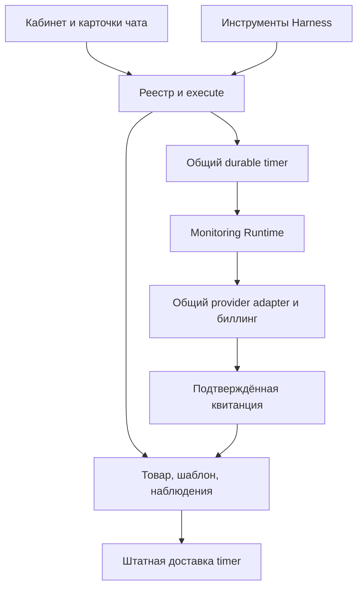

# Мониторинг закупочных цен: предметный контракт кандидата

Этот документ описывает реализованные границы и способы проверки кандидата. Он не заменяет приёмочную матрицу и не утверждает готовность заблокированных внешних маршрутов. Основное [ТЗ-МЦ-001](https://github.com/MaksimUnimax/Master/blob/784ac82bd3980a2c2d97d873cda994ed0247fa2a/docs/PURCHASE_PRICE_MONITORING_SPEC_RU.md) и [правило CORE-DUAL-01](https://github.com/MaksimUnimax/Master/blob/417b7669c13ad42948f07bab048958ebbb424e4b/docs/CORE_DUAL_CONTROL_RU.md) доступны по закреплённым ссылкам. Полные копии обязательных документов, исходные SHA и Git blob SHA сохранены в `docs/reference/` и `docs/reference/origins.json` закрытого исходного bundle. Пути `evidence/…` в отчётных документах относятся к закрытому ZIP, а не к файлам публичного GitHub.

## 1. Одна операция для кабинета, чата и таймера

Предметный модуль — `products/harness-platform/platform_core/purchase_monitoring.py`. Его `REGISTRY` содержит 15 действительных обработчиков, схемы входа и выхода, роли, эффекты, правила подтверждения, UI/chat bindings, `error_policy` и `progress_policy`. `execute(db, scope, operation, arguments, request_id=..., now=...)` проверяет текущие права, типы аргументов и результат. Оба направления используют JSON Schema Draft 2020-12. Числовая цена в виде JSON float не проходит выходной контракт.

Кабинет обращается к `purchase_monitoring_api.invoke`, а инструменты и точные команды чата — к `purchase_monitoring_chat`. Оба адаптера вызывают тот же `execute`. Исполнитель не обрабатывает свободный текст команды повторной отдельной бизнес-логикой: `purchase_monitoring_runtime` связывает общий timer, предметное ядро, parser.market и общий финансовый журнал.

Отдельных очереди, cron, фонового цикла предметного модуля, кошелька или расчёта себестоимости нет. Длительное ожидание источника записывается в существующий `timer_runs.retry_at`, после чего worker освобождается. parser.market продолжает исходный заказ, а не оформляет новый.

## 2. Публичные операции

Вызов HTTP: `POST /api/chats/{chat_id}/monitoring/operations` с объектом `{"operation":"monitoring.add","arguments":{"url":"https://..."},"requestId":"..."}`. `scope` устанавливает сервер из действующей сессии. Поля `actor`, `workspace`, `admin`, результат провайдера и финансовые разрешения отсутствуют в пользовательских схемах. Неизвестные поля отклоняются.

Идентификаторы реестра имеют префикс `monitoring.`; короткие имена принимаются как совместимые алиасы. Изменяющим командам нужен стабильный `requestId`. Повтор идентификатора с другим содержимым возвращает конфликт. После удаления прежние ответы таких команд заменяются обезличенной записью удаления.

| Операция | Существенные аргументы | Результат / действие |
|---|---|---|
| `add` | `url`, необязательно `name` | Одна каноническая позиция; повтор ссылки возвращает ту же позицию. Расписание ещё не включено. |
| `list` | `limit`, `offset`, `status` | `items`, `total`, `next_offset`. |
| `get` | `item_id` | Текущая публичная карточка. |
| `rename` | `item_id`, `version`, `name` | Ручное название, которое следующая проверка не перезапишет. |
| `configure` | `item_id`, `version`, хотя бы одно из `schedule`, `criteria`, `channels`, `url`, `region` | Новая версия настроек; отзыв прежнего допуска. |
| `check` | `item_id`, `version` | Идемпотентная ручная occurrence в общем timer; перекрытие возвращает действующую проверку. |
| `start` | `item_id`, `version` | Явное включение после подтверждения цены и настройки расписания. |
| `pause` | `item_id`, `version` | Ручная пауза, история сохраняется. |
| `resume` | `item_id`, `version` | Продолжение с будущего срока после проверки причин остановки. |
| `stop` | `item_id`, `version` | Остановка и отзыв старых разрешений; история сохраняется. |
| `clarify` | `item_id`, `version`, `clarification_id`, ровно одно из `option_id` / `answer` | Атомарное сохранение выбора, закрытие вопроса, новая версия короткого правила и проверка. |
| `history` | `item_id`, необязательно `series`, `from`, `to`, `before`, `limit`, `max_points` | Страница наблюдений, точные агрегаты по сериям, ограниченный график. |
| `export` | Те же фильтры истории, `limit` до 5000 | Страница CSV, `next_cursor`, `has_more`; все значения цены остаются строками. |
| `costs` | `item_id`, необязательно `run_id`, `limit`, `offset` | Только текущий admin; проекция общего финансового журнала. |
| `delete` | `item_id`, `version`, `confirm:true` | Удаление предметной истории при сохранении общих финансовых записей. |

`version` защищает от одновременных несовместимых изменений формы и чата. `template_version` отдельно связывает извлечение с коротким правилом. Версия timer event отзывает старые запуски при паузе, остановке, удалении или изменении настроек.

В карточке отдельно представлены `task_state` и `last_status`; последняя достоверная цена не превращается в ноль из-за ошибки текущей попытки. Публичные даты наблюдений — UTC Unix seconds, `next_at` — ISO timestamp. Общий timer продолжает использовать свои микросекунды.

Для незавершённого run текущей revision поле `last_status` проецирует общий timer: `checking` во время чтения и `waiting_retry` при отложенном checkpoint. Отдельное nullable `retry_at` — UTC Unix seconds из `timer_runs.retry_at`, не микросекунды `due/lease_until` и не следующий плановый срок `next_at`. Это проекция чтения: она не меняет предметное состояние, версию, очередь или последнюю подтверждённую цену. Уже применённый окончательный результат, вопрос, финансовая пауза и пауза поставщика сохраняют свой статус.

После окончательного результата запланированной разовой проверки `task_state='completed'` отражает завершение общего timer. Эта смена происходит в одной транзакции с результатом и не увеличивает revision события, поэтому итоговое уведомление сохраняет действующий допуск. Финансовая пауза, неизвестный исход, вопрос и пауза поставщика не перезаписываются завершением. Запуск прошедшего `once` отклоняется; новая будущая дата после настройки требует явного `start`. Ручная проверка завершённого товара не включает расписание заново.

### Поля расписания и одинаковый ввод

Кабинет и карточка чата поддерживают разовую проверку (`once`), точный интервал (`interval`), дни недели (`calendar`) и дни месяца (`monthly`). Разовая дата передаётся ISO-строкой с явным смещением и сохраняет исходные дробные секунды; браузер не подменяет её своим часовым поясом. Все времена календарного правила доступны для редактирования; правило не сокращается до первого времени. IANA-зону проверяет общий серверный timer. Если расписание не редактировали, форма не отправляет его заново и сохраняет прежний anchor/полный набор времён.

Для **всех входов мониторинга** интервал задан целым числом микросекунд от `1` до `9007199254740991` (`2^53 − 1`, около 285 лет). Это явная граница точного целого JSON в браузере, одинаковая в input/output schemas, server validator, кабинете, точной команде и инструменте чата. Глобальный контракт timer для других функций не изменён. UI переводит десятичный ввод в микросекунды через `BigInt`, а в JSON Number — только внутри этой границы; дробь меньше микросекунды и превышение не округляются.

Фильтр таблицы использует только enum `task_state`. История поддерживает выбор серии и включительные временные границы UTC; выгрузка сохраняет те же фильтры на всех страницах. Административные расходы читаются постранично через `monitoring.costs` и могут быть ограничены конкретной исходной проверкой. Каждая такая страница заново проходит текущий server role/scope check; UI не вычисляет расход. Необязательное имя при добавлении находится в закрытом разделе «Дополнительно» — основной ввод остаётся только ссылкой.

Точные команды `/monitor list`, `history`, `export`, `costs` сохраняют в указателе карточки только проверенные селекторы `query`: состояние, границы периода, серию, курсор/страницу и исходный `run_id` для расходов. Карточка сразу открывает запрошенное представление. Она перечитывает данные через тот же авторитетный handler; CSV, цены, наблюдения и расходы в таком указателе не хранятся. Для `export` скачивается выбранная страница с исходными фильтрами и отдельным продолжением по `next_cursor`; выгрузка из обычной формы истории проходит все страницы выбранного периода. Получение очередной страницы расходов всегда заново проверяет текущую роль admin.

## 3. Схема и миграции

`initialize(db)` вызывает штатную инициализацию timer и общий `schema_migrations.apply`. Миграция `20261128_purchase_monitoring_v1` добавляет предметные таблицы; `20261128_purchase_monitoring_maintenance_v2` добавляет индексы обслуживания, не меняя старую миграцию. Повторная инициализация проверяется без дублирования данных.

Связанные миграции provider сохраняются в его штатном initializer: `20261128_parser_market_v1` — исходные jobs; `20261128_parser_market_monitoring_v2` — `authorization_kind`/`authorization_id`; `20261128_parser_market_shared_quota_v3` — общий координатор квот; `20261128_parser_market_monitoring_run_v4` — уникальный индекс `authorization_id` для `authorization_kind='monitoring'`. Последний физически закрепляет один заказ на предметный run. Старые миграции и их checksum не переписываются.

| Таблица | Назначение | Чего в ней нет |
|---|---|---|
| `pm_price_items` | Владелец, мастерская, чат, URL, название, версии и состояние задачи, настройки уведомлений, ID общего event | Балансов, тарифов, токенов модели, себестоимости |
| `pm_price_templates` | Короткая инструкция, выбор предложения, ожидаемые условия, версия | HTML страницы, длинного промпта, истории диалога |
| `pm_price_series` | Валюта и условия сравнения серии | Финансовых агрегатов |
| `pm_price_observations` | Точная decimal-строка, время, серия, уникальная occurrence, версия шаблона | HTML, полного ответа модели, бинарного float |
| `pm_price_clarifications` | Единственный открытый вопрос на товар, реальные варианты, ответ и версия | Отдельного состояния вопроса для чата |
| `pm_price_run_bindings` | Связь общего run с товаром, версией и стадией, digest применённого результата | Собственной очереди или расписания |
| `pm_price_attempt_links` | Связь исходного общего attempt/run с товаром и стадией | Копии денежных значений или второй бухгалтерии |
| `pm_price_commands` | Идемпотентность команд и публичный ответ | Административных денежных проекций |
| `pm_price_financial_episodes` | Дедупликация уведомления о нехватке на аккаунт | Баланса или суммы расхода |

Ограничения уникальности защищают URL в мастерской, observation на run, общий attempt в привязках, открытый вопрос на товар и команду на аккаунт. Индексы обслуживают таблицу товаров, последние наблюдения, временные фильтры, серии, привязки попыток и run. Дополнительные индексы `pm_price_run_outcome`, `pm_price_items_maintenance`, `pm_price_attempt_pending` предотвращают полный просмотр накопленной истории при штатном поиске неопределённых и финансово приостановленных задач.

При удалении удаляются предмет, шаблоны, серии, наблюдения и уточнения. Общие event/run закрываются для новых отправок и доставки; их предметный payload очищается. Привязки общих финансовых попыток сохраняются вместе с исходным журналом: уже выполненный внешний эффект всё ещё можно сверить. Старый command replay не восстанавливает удалённый URL.

## 4. Авторизация платного запуска

`authorized` проверяет `capability_registry`, владение основным чатом, мастерскую и действующий жизненный цикл аккаунта/мастерской. Права не сохраняются как бессрочный флаг. Стоимость требует отдельной capability `monitoring.costs` с текущей ролью admin.

`item_for_run(db, scope, event, run)` возвращает предметный снимок: URL, имя, источник, короткую инструкцию, `selection`, `expected_context`, версию, стадию, manual flag, ревизию и текущую lease. Регулярный run требует активной задачи. Вопрос, финансовая пауза, запрет поставщика и неизвестный исход останавливают новые отправки.

`authorize_dispatch` проверяет текущий item, шаблон, event revision, реальное состояние run и конечный срок lease непосредственно перед использованием разрешения. Для отложенного parser job разрешён `queued` только при наличии неизменного исходного attempt, ещё действующей lease и точной привязки к текущему run. Параметры сохранённого заказа сравниваются с `price.definition(url, region, selection)`: другая карточка, регион или выбранное предложение не получат платного допуска.

`authorize_provider(..., payload=...)` проверяет то же соответствие до первого резерва. Повтор команды с тем же request ID возвращает первоначальный заказ. Иной request ID не может приобрести второй заказ по тому же разрешению run. `GrantExpired` означает необходимость обновить конечный допуск тем же timer; provider ждёт исходную проверку и не освобождает/покупает резерв заново. Явный отзыв прав или версии прекращает неотправленный заказ. Уже отправленный заказ допускает только чтение исходного результата для сверки.

Никакая пользовательская cookie, токен `chat.turn` или бессрочный модельный grant для этого не сохраняется.

## 5. Результат, краткий шаблон и уточнение

Домен использует один классификатор `parser_market.price.classify`, основанный на общей проверке публичного URL. Поддержанные маркетплейсы требуют точную карточку; похожий домен не получает привилегий площадки. Для маркетплейса задан один товар и верхняя граница одной проверки, без Search. Детальный внешний контракт и ограничения живой приёмки — в `PROVIDER_CONTRACTS_RU.md`.

`apply_observation` — внутренний метод доверенного адаптера. Его нельзя вызвать пользовательской операцией. Нужны `transport_verified:true`, подтверждённый `checked_url` того же товара, компактная схема и текущая версия. Допускается decimal-строка или целое число минимальных единиц; бинарный float, NaN и бесконечности отклоняются. Дробные копейки не округляются. Ноль допустим лишь с явным `free_confirmed:true`; отсутствие значения всегда остаётся отсутствием значения.

Сравнимость определяется валютой и минимальным структурированным `basis`. Смена единицы, упаковки, продавца, валюты, региона или типа цены требует подтверждения и новой серии. Старая история остаётся доступной. Доказанное перемещение того же ценового блока обновляет короткий locator и версию без ложного нового изменения цены. Выбранный stable `option_id` сохраняется; числовая цена не служит ориентиром поиска.

Один вопрос хранится на товар и исходный run. Его показ в кабинете и чате использует одну запись. Ответ проверяет `item.version`, `clarification_id` и `template_version`; сохранение ответа, закрытие вопроса, новая версия правила и постановка проверки атомарны. До ответа новая платная проверка не запускается. Выбор переживает нехватку средств. Свободный текст — ограниченные данные условия, которые не меняют системные правила, разрешённый инструмент, URL или бюджет.

Публичный вопрос содержит исходный `run_id`. Кнопка кабинета «Ответить в чате» обновляет штатную native-историю, открывает уже опубликованное сообщение этой проверки и ту же форму уточнения; новый разговорный или платный запрос не создаётся. Ответ своими словами принимает до 600 символов без обрезки и без служебного префикса, который сократил бы заявленную длину.

Для `structure_changed` домен принимает контролируемое уточнение с реальными вариантами. Автоматический DeepSeek цикл перенастройки не объявлен принятым, пока сам маршрут Read URL заблокирован внешним контрактом. Это должно оставаться явно отмеченным в матрице MC, а не маскироваться синтетическим успешным прогоном.

### Ограничение Read URL и платного допуска

Маршрут обычных сайтов намеренно не включает платный вызов только по признаку существования DeepSeek ключа или доступного gateway. `purchase_monitoring_runtime` запрашивает read-only status зарегистрированного шлюза с отдельным ограниченным `purchase.monitoring.status` grant. Этот grant не создаёт денежный заказ. Проверены URL шлюза, отсутствие credentials/query/redirects, ограничение размера ответа и отзыв grant после запроса.

Принятый в кандидате ответ статуса — `purchase-price-read-url/1`, `state='contract_blocked'`, `safe_bound=null`. Внешний флаг не может самостоятельно включить платное чтение. Нужны отдельный рассмотренный контракт верхней границы, binding точного публичного URL/server tool, корректный reserve перед чтением, проверенные usage/receipt и адаптер их сверки. До их приёмки `contract_blocked` сохраняет прежнюю цену и создаёт **ноль** платных попыток. Standalone Fetch или Search не используются как скрытый обход заблокированного маршрута.

## 6. Уведомления и состояние попытки

Критерии — массив условий, соединённых логическим «ИЛИ». Несколько совпадений дают один результат на канал и одно сообщение с перечислением причин. Все сравнения выполняются локально с `Decimal`; модель не принимает решений о расписании, пороге или кошельке.

| Критерий | Значение |
|---|---|
| `all` | Каждая успешная запланированная проверка |
| `change` | Любое изменение с последней сопоставимой успешной ценой |
| `increase`, `decrease` | Строгий рост / снижение |
| `amount` | Изменение не менее `value`, с `direction:any/increase/decrease` |
| `percent` | Та же направленность, точный процент; отсутствующая/нулевая база не делится |
| `threshold` | Только пересечение границы `lte` / `gte`; повтор на том же значении не сигналит |

Первое наблюдение является базой; при новой серии изменение предыдущей серии не сравнивается. Сообщение содержит имя, старую/новую цену при их наличии, процент, единицу, сработавшие условия, UTC момент и URL. Ручная проверка и первоначальное уточнение возвращают результат в основной чат; плановые уведомления используют выбранные `chat`, `telegram` или оба. Фактическая доставка, её дедупликация, отзыв и неопределённость принадлежат существующему timer.

`mark_outcome` не принимает текст провайдера как пользовательское сообщение: использует фиксированные безопасные формулировки. CAPTCHA пропускает наблюдение; активная задача ждёт своего следующего срока. Авторизация сайта не обходится. `waiting_retry` и `rate_limited` не становятся завершённым ценовым результатом и могут продолжиться под тем же run. `contract_blocked` показывает «Проверка этого источника пока недоступна» и не создаёт платного attempt.

При недостатке клиентского баланса сохраняются история, настройки, выбранное условие и незаконченная стадия. `required_coins` приходит из общей сметы и баланса, не из выдуманного порога. Одно уведомление на начало эпизода аккаунта. `resume_financial` получает callback общего тарифа и кошелька и возобновляет только точную финансовую причину, максимум один незавершённый текущий run, без воспроизведения всех пропусков. Ручная пауза/остановка не возобновляется.

`unknown` блокирует новую платную проверку, включая попытку обойти блок остановкой/новым request ID. `reconcile_unknown` не является пользовательской командой. Он наблюдает подтверждённое завершение исходных связанных попыток в общем ledger, проверяет свидетельство, состояние и согласованность тарифа/списания. После денежной сверки цена не выдумывается: состояние результата `no_price`, прежнее наблюдение остаётся. Явная последующая ручная остановка сохраняется; ранее активное расписание продолжится только с будущего момента.

## 7. Расходы и отсутствие утечки после смены роли

`bind_attempt` хранит только идентификаторы и стадию: `setup`, `clarification`, `reconfigure`, `regular`, `manual`, `diagnostic`, `retry`. Привязка проверяет владельца исходной записи `coin_attempts`/`usage_operations`; повторная атрибуция чужому товару/run отклоняется.

`costs` использует `finance_reporting.rows`, `summarize` и `public_attempt(administrative=True)`. Тариф, usage, фактические единицы, остаток резерва, квитанция и деньги не вычисляются второй раз. Неизвестная себестоимость представлена `null` и признаком неполноты, а не нулём. Проекции `summary`, `setup`, `clarifications`, `last_check`, `retries`, `attempts` строятся в момент чтения.

Обычные операции, в том числе вызванные admin, не кэшируют денежную проекцию в предметной команде. HTTP добавляет её после текущей проверки роли. В обычном transcript и timer receipt сохраняется указатель `monitoringCard:{item_id,run_id,kind,operation,query?}`. Необязательный `query` содержит только перечисленные выше селекторы чтения. `purchase_monitoring_chat.present` пересобирает карточку при чтении и повторно проверяет роль; модельные инструменты стоимости не получают. Старый текст или metadata не должны переживать отзыв роли как разрешение показывать деньги.

Разворачиваемая техническая детализация выводит подтверждённые поля общей проекции: себестоимость RUB/USD, монеты и резерв, поставщика, модель/вид операции, исходную квитанцию, стадию/состояние, единицы, разрешённые счётчики токенов, версии тарифов/клиентской цены и курс. Отсутствующее поле показано как отсутствие данных; неизвестный расход — «не подтверждена». Для parser.market не выдумываются токены модели или себестоимость USD. Весь сырой `usage`, финансовые `evidence` и ответ поставщика в UI не выводятся.

## 8. Проверка и честные границы доказательств

Предметная suite: `PYTHONPATH=products/harness-platform python3 -m unittest discover -s products/harness-platform/tests -p test_purchase_monitoring.py -v`. Она работает с настоящими SQLite, регистрацией, scope/capability, timer store и общим финансовым резервированием/settlement; сетевых вызовов нет. Компактные результаты являются контролируемыми fixture адаптера, а не живыми ценами. Проверены точность, ложный ноль, версии, вопросы, паузы, роль, чужие мастерские, повреждённый payload, finite lease, исходный unsettled attempt, сверка unknown, история, удаление и конкурентный одинаковый request.

Отдельные HTTP, runtime/resilience и stress проверки используют общий исполнитель и подменяют только внешний provider transport. Read URL guard не отключается ради зелёного теста. Обязательная живая выборка, расход, Telegram, квоты и provider контракт проверяются отдельно и остаются `BLOCKED`/`NOT_RUN`, если внешнего допуска или подтверждения нет.

Storage benchmark: `acceptance/purchase_monitoring_storage.py --items 1000 --days 365 --samples 50 --output ...`. План, лимиты и fingerprint исходников записываются **до** измерений. Используются настоящая схема, индексы, авторизация и read handlers. Исторические наблюдения засеиваются напрямую. Измеряются размер SQLite, память, время заполнения, p50/p95/p99 таблицы, карточки, истории и экспорта; проверяются FK и integrity. Отчёт прямо указывает, что не моделирует объём общих финансовых квитанций и timer run journal. Это доказательство компактного хранения, а не E2E поставщика.

Приёмку привязывать к окончательному SHA и fingerprint; результаты старого кандидата не переносить автоматически. `acceptance-template.json` содержит все 50 MC и 8 DUAL дословно. Итоговый статус требует отдельных доказательств для каждого применимого пункта и не следует из одного количества пройденных unit tests.

## 9. Остановка перед откатом и восстановление

Обратное удаление таблиц/миграций не является безопасным откатом. Перед переключением на код без мониторинга нужно прекратить выдачу новых запусков штатной `stop`, отозвать старые event revisions и дождаться окончательной сверки уже отправленных операций. Неопределённый/отправленный общий attempt, незаконченная доставка и активная lease блокируют переключение. Остановка предметной задачи не является доказательством отсутствия внешнего списания.

После сверки сохраняются общая бухгалтерия, исходные provider receipts, timer journal, native chat и все версии миграций. При возврате старого бинарника используется проверенная совместимость с добавленными таблицами; удаление или обнуление финансовых записей недопустимо. Восстановление более старой копии не отменяет внешние списания, отзыв интеграционных ключей или уже доставленные сообщения.

В `acceptance/purchase_monitoring_restore.py` предусмотрена отдельная изолированная репетиция: synthetic supplier, реальный общий исполнитель/журнал, запрет downgrade до квитанции, quiesce через действительные операции, SQLite backup API для identity/native chat и перенос в **новый** каталог. Дополнительно сохраняется действующий append-only journal отзыва marketplace keys: его нельзя заменить более старым журналом при восстановлении. Ключи поставщиков в backup не копируются; лаборатория создаёт собственный заведомо нерабочий внешний credential.

Репетиция проверяет SQL integrity/FK, канонические хеши предметных данных/финансовых записей/native сообщений до и после восстановления, чтение восстановленного предмета штатным API и отсутствие нового платного dispatch. Это `isolated restore rehearsal`, не доказательство rollback работающего production и не разрешение заменять его данные.
